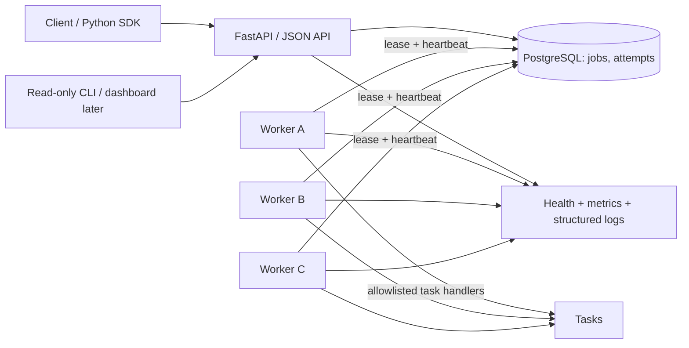

# AsyncForge — Production-shaped MVP Architecture

**Status:** v0.1 source implementation exists; PostgreSQL runtime acceptance and GitHub CI remain **unverified**. No production deployment or GitHub repository creation implied.
**Date:** 2026-10-31
**Goal:** A general-purpose, durable, locally runnable Python task execution engine rather than a domain-specific scheduler.
**Budget:** 0 TL (local development, free/open-source dependencies; no paid cloud, APIs, or runner required).

## 1. Portfolio collision audit

The AFK account lists 71 repositories. Relevant READMEs and selected source files were inspected:

| Existing repository | Existing capability | AsyncForge boundary |
|---|---|---|
| `industrial-iot-telemetry-platform` | Redis Streams consumer groups (`XREADGROUP`, `XACK`, `XCLAIM`), streaming telemetry, alert retry and in-memory DLQ | Highest overlap. AsyncForge is a generic durable job runtime, with PostgreSQL job/attempt history, atomic leases, fencing, API idempotency and worker SDK; not an IoT stream or webhook handler. |
| `auto-video-publisher` | Domain-specific publishing slots, claims, retries, platform integrations | No Meta, Google Drive, YouTube calls or shared publishing state in MVP. Only isolated demo jobs. |
| `edgesentinel-fleet` | Offline edge event buffer, retries, sync | Device-side telemetry buffering, not generic multi-worker dispatch. |
| `openmontage-video-factory` | Single-job local lock, rendering pipeline | No video production in MVP. |
| `incident-hub` | Log incident aggregation / deduplication | No log incident classification. AsyncForge exposes job history and failures. |
| `project-control-center` | GitHub repo and CI metadata audit | No GitHub workflow execution or modification. |

This was a targeted content audit, not a proof that none of the 71 repositories contains another undocumented scheduler. No `asyncforge` repository name appeared in the examined repo list; name availability must be checked again before creation.

## 2. Architecture decision

**PostgreSQL is the single source of truth and the queue in v0.1.** No Redis requirement in the MVP. This is an intentional portfolio differentiator and eliminates a second datastore/synchronization problem. `SELECT ... FOR UPDATE SKIP LOCKED` supports multiple consumers of a queue-like table; PostgreSQL documents that behavior: https://www.postgresql.org/docs/current/sql-select.html.

Services for local Docker Compose: `api`, `worker` (replicas optional), `postgres`. Optional one-off migration service. Scheduled jobs are ordinary records with `run_at`; workers claim them only when due. A periodic reconciliation loop marks exhausted stale running jobs `dead`. Do not use PostgreSQL `NOTIFY` as the only delivery mechanism: notifications are not persistent work records.

### Technology choices

- Python 3.12, FastAPI, Pydantic v2
- PostgreSQL 16+ (local container), SQLAlchemy 2 + psycopg 3, Alembic migrations
- Worker loop: Python process, process-level parallelism, graceful SIGTERM shutdown. No arbitrary Python import or shell execution from incoming payloads.
- `pytest`, `pytest-cov`, `ruff`, `mypy` (progressive), HTTPX, isolated integration tests
- Docker Compose, structured JSON logs, Prometheus-compatible `/metrics`; OpenTelemetry tracing is a follow-up, not an MVP dependency.

## 3. API contract (v0.1)

- `POST /v1/jobs`: `{task_type, queue, payload, run_at?, priority?, max_attempts?}`; require an `Idempotency-Key` header for write safety. `201 Created` on new job, `200 OK` + existing job for an identical repeat, `409 Conflict` for same key and different effective request.
- `GET /v1/jobs/{id}`: state, timestamps, sanitized error, result summary, attempt count.
- `GET /v1/jobs?state=...&queue=...`: paginated list with bounded page size.
- `GET /v1/jobs/{id}/attempts`: sanitized attempt metadata.
- `POST /v1/jobs/{id}/cancel`: only `queued` jobs in v0.1; `409` for running/terminal tasks.
- `POST /v1/jobs/{id}/replay`: explicit operator action, creates a new job from a `dead` job with distinct ID and replay linkage; never silently reuses completed idempotency keys.
- `GET /health/live`, `GET /health/ready`, `GET /metrics` (metrics access private by default).

Demo allowlisted tasks: `demo.sleep`, `demo.sha256`, `demo.fail_n_times`. The handler registry is set in trusted Python configuration; caller-supplied arbitrary code, command, import path, URL or webhook target is forbidden.

## 4. Data model

`jobs`: `id` UUID primary key; `client_id`; `idempotency_key`; `request_hash`; `task_type`; `queue`; `payload JSONB`; `state` (`queued/running/succeeded/dead/cancelled`); `priority`; `run_at timestamptz`; `attempts`; `max_attempts`; `lease_owner`; `lease_until`; `lease_generation`; `result JSONB`; `last_error_code`; `created_at`; `updated_at`.

`job_attempts`: `id`, `job_id`, `attempt_no`, `lease_generation`, `worker_id`, `started_at`, `finished_at`, `outcome`, `error_code`, `duration_ms`.

`job_events` (minimal append-only audit): `id`, `job_id`, `event_type`, `occurred_at`, `details JSONB` (safe, bounded; no credentials).

Indexes: partial runnable index `(priority DESC, run_at ASC, created_at ASC)` for queued jobs; stale-lease index on running jobs; unique `(client_id,idempotency_key)` when key not null; job attempts `(job_id,attempt_no)` unique. All times UTC. DB server clock is authoritative for leases.

## 5. Claim/lease algorithm

In one short database transaction:
1. Select a due queued job or expired running job with `attempts < max_attempts`, ordered by priority/run time, `FOR UPDATE SKIP LOCKED LIMIT 1`.
2. Update to `running`, increment `attempts` and `lease_generation`, set `lease_owner` and 60-second `lease_until`, record attempt, COMMIT.
3. Execute outside the transaction. Heartbeat every 20 seconds extends the lease only if `(job_id, worker_id, lease_generation)` still matches.
4. Record success/failure only if the same lease generation remains current. On transient failure, move to `queued` with bounded exponential backoff + jitter; otherwise `dead`.
5. A reaper marks expired exhausted leases `dead`. Recovery may execute the task again; stale workers' late acknowledgements must not overwrite the new result.

**Semantics: at-least-once execution. Not exactly-once side effects.** After a worker performs an external action but dies before recording success, re-execution is possible. External effects need their own idempotency/reconciliation contract. MVP demo handlers have no external production side effects.

Timeouts: per-task execution limit and bounded JSON payload/result sizes. Heavy/untrusted Python is not accepted; allowlisted tasks remain trusted. Hard cancellation of a wedged handler can be added with subprocess isolation in a later milestone.

## 6. Security and operational defaults

- Local host-only ports; API authentication via scoped API key, stored as a hash; `health/live` can be public on loopback only. No default public exposure.
- No tokens in code, Git, Docker images or test snapshots. `.env.example` contains placeholders only; `.env` ignored.
- Payload schema validation and bounded max size; masked error output; rate limits or reverse-proxy protections before any Internet deployment.
- When PostgreSQL is unavailable: fail closed and report `503` readiness; never drop to an in-memory queue.
- Graceful worker shutdown stops claiming and finishes/leaves leased tasks for recovery.
- Operators can inspect and explicitly replay dead tasks; replay is audited.
- Do not connect to existing live social media / Gmail / Drive workflows during v0.1.

## 7. Non-goals for MVP

No Celery wrapper, Redis Streams, Kafka, Kubernetes, multi-tenant RBAC, cron expression support, UI dashboard, autoscaling, cross-region failover, exactly-once guarantees, arbitrary Python code execution, external publishing, or paid hosting.

## 8. Sources / portfolio references

- https://github.com/emirhankaya-AFK/industrial-iot-telemetry-platform
- https://github.com/emirhankaya-AFK/auto-video-publisher
- https://github.com/emirhankaya-AFK/edgesentinel-fleet
- https://github.com/emirhankaya-AFK/openmontage-video-factory
- https://github.com/emirhankaya-AFK/incident-hub
- https://github.com/emirhankaya-AFK/project-control-center
- https://www.postgresql.org/docs/current/sql-select.html
- https://opentelemetry.io/docs/languages/python/instrumentation/
